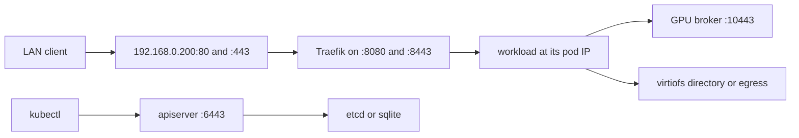
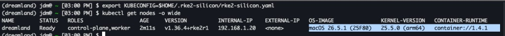

# rke2-silicon

Single-node Kubernetes on Apple Containers. `rke2-silicon up` starts the control plane as containers and returns. A per-user LaunchAgent heartbeats the node and starts pods. Each container is a Linux micro-VM. The catalog is Kubernetes 1.36.4: RKE2 `v1.36.4+rke2r1` and K3s `v1.36.4+k3s1`.

The node is for work that pulls or reads here, processes on this Mac, and writes to a store that already has an address. [docs/edge.md](docs/edge.md) is that shape beside a typical edge appliance.

## What runs

The RKE2 installer is not in this tree and is never executed. [docs/rke2.md](docs/rke2.md) is the relationship to an RKE2 release and to a traditional installation. There is no `rke2` binary, install script, containerd, or kubelet.

`kubernetes-version` selects a row in the catalog. A version that is absent fails. That row names the container images Rancher publishes for the release. For `v1.36.4+rke2r1` they are `docker.io/rancher/hardened-kubernetes:v1.36.4-rke2r1-build20260821` and `docker.io/rancher/hardened-etcd:v3.6.14-k3s1-build20260819`. `up` writes certificates on the Mac, mounts `~/.rke2-silicon` at `/var/lib/rke2-silicon`, and starts four containers. The Apple `container` CLI pulls an image the first time that name is started. Each container runs one binary from the image:

| Process | Image | Binary |
| --- | --- | --- |
| etcd | hardened-etcd | `/usr/local/bin/etcd` |
| kube-apiserver | hardened-kubernetes | `/usr/local/bin/kube-apiserver` |
| kube-controller-manager | hardened-kubernetes | `/usr/local/bin/kube-controller-manager` |
| kube-scheduler | hardened-kubernetes | `/usr/local/bin/kube-scheduler` |

`config.yaml` uses RKE2's keys. Those keys become process arguments. The processes do not read the file.

When the apiserver answers, `up` creates the node and the ConfigMap `kube-system/rke2-silicon-version` through the API. The LaunchAgent is the kubelet. It heartbeats the node and starts each pod as a container. CNI, kube-proxy, CoreDNS, and the RKE2 charts are not installed. Traefik is a Deployment this installer applies.

A K3s release is the catalog row `v1.36.4+k3s1`, image `docker.io/rancher/k3s:v1.36.4-k3s1`, and one container, `rke2-silicon-k3s`, running `k3s server`. The agent, Flannel, and the packaged charts stay disabled. The same LaunchAgent starts pods. A later `up` with the same version leaves the running containers in place. Moving to another catalog row is `upgrade`.

## Registry token realms

The container CLI pulls images. It refuses a registry whose token service is on another domain. When a start fails that way, rke2-silicon downloads the image, loads it into the local store, and tags it with the name the pod asked for. The retry, and every later start of that name, uses the local image. The same path applies to every registry that fails this check. A private registry uses the credentials in the Docker config.

## How a packet moves



Traefik, the workload, the apiserver, and the datastore are containers on `192.168.128.0/24`. The Mac is `192.168.128.1` on that network. The forwarder and the GPU broker are host processes.

`ingress-address` is a `/32` alias on the LAN interface whose subnet contains it. The Mac answers ARP for it and delivers it locally. Keep it out of DHCP, or by reservation on your network. It is not `node-ip`, and the Mac's own address does not answer 80 or 443.

The container CLI refuses host ports below 1024, and its daemon rejects a root client. Traefik is the only published pod, on `ingress-address:8080` and `:8443`. A root LaunchDaemon, `rke2-silicon forward`, accepts 80 and 443 on that address and connects to those ports. `up` installs the alias and the daemon with `sudo -n`.

Traefik reads Ingress objects and dials the backend at its pod IP. That is the LAN path. ClusterIP, NodePort, and LoadBalancer remain records. There is no CNI, kube-proxy, or CoreDNS: those exist so some other machine can open a connection to a pod. The workloads below finish by a write, or by a connection the pod opens. One node has nothing for an overlay to span.

`kubectl` uses `https://127.0.0.1:6443`. Port 6443 is published on every host address. Pods reach each other on the vmnet, the broker at `192.168.128.1:10443`, host directories through virtiofs, and any other destination through the Mac. `127.0.0.1` inside a guest is that guest.

## Workloads

| Workload | Path |
| --- | --- |
| Line inspection | The pod dials a camera gateway or broker, holds one `apple.com/gpu` share, and appends the result to a historian or a directory. |
| Condition monitoring | The pod dials the source and writes a window to a store, or appends a file on an NFS export the Mac has mounted. `examples/nfs`. |
| Instrument drop | A bench writes a host directory. The pod reads it through virtiofs and writes the report beside it. `examples/pv` is that directory as a PersistentVolume. |
| Shift-batch inference | The pod reads a spool and writes scores. Four pods hold GPU shares. A fifth stays Pending. `examples/gpu`. |

`apple.com/gpu` is a concurrency limit, not a device partition. The broker runs a Metal add-one kernel. `POST /v1/compute` with `{"values":[1,2,3,4]}` returns `{"values":[2,3,4,5]}`. The node advertises four shares.

## Config

`config.yaml` is the server file. Unknown keys fail `up`. `kubernetes-version` selects the catalog image.

| Key | Effect |
| --- | --- |
| `kubernetes-version` | RKE2 or K3s release. A version change requires `upgrade`. A distribution change is rejected. |
| `datastore` | `etcd` or `sqlite`, on this Mac. RKE2 is `etcd`. K3s defaults to `sqlite`; `etcd` is one embedded member. It cannot change after the first `up`. |
| `node-name` | Node name. Omitted, the short hostname. |
| `node-ip` | `InternalIP`. |
| `ingress-address` | `/32` alias for Traefik. Distinct from `node-ip` and from `192.168.128.0/24`. |
| `tls-san` | Extra apiserver names. Omitted, `node-ip`. `up` reissues the serving certificate when a required name is missing. The CA and client certificates stay. |
| `service-cidr` | Default `10.43.0.0/16`. |
| `kube-apiserver-arg`, `etcd-arg`, `kube-controller-manager-arg`, `kube-scheduler-arg` | Extra flags for that process. The last copy of a flag wins. |

```yaml
kubernetes-version: v1.36.4+rke2r1
node-name: dreamland
node-ip: 192.168.1.20
ingress-address: 192.168.0.200
tls-san:
  - 192.168.1.20
```

`examples/config-k3s.yaml` is the same node on K3s with sqlite. Both role labels are always set.

## Run

macOS 26 on Apple silicon, Apple `container` CLI 1.4.1 or newer, `kubectl`, and Go 1.26. Passwordless `sudo` for `/sbin/ifconfig` and for installing the forwarder LaunchDaemon.

```sh
go build -o rke2-silicon ./cmd/rke2-silicon
./rke2-silicon up --config config.yaml
export KUBECONFIG=$HOME/.rke2-silicon/rke2-silicon.yaml
kubectl get --raw=/readyz
kubectl get nodes -o wide
```

`/readyz` returns `ok`. The node is Ready. `VERSION` is the catalog release. `CONTAINER-RUNTIME` is the Apple container CLI.



`up` creates the `rke2-silicon` network on first start. A later `up` with the same images leaves a healthy cluster in place. `stop` and `down` stop containers named `rke2-silicon-*` and containers on the `rke2-silicon` network. `uninstall` deletes those containers, including ones that are already stopped. `~/.rke2-silicon` and the alias stay. `--purge` on `stop`, `down`, or `uninstall` deletes the containers, that network, `~/.rke2-silicon`, the ingress alias, the LaunchAgent, and the forwarder. `upgrade` snapshots the datastore, then rolls images. It rejects a downgrade and a jump of more than one Kubernetes minor.

```sh
./rke2-silicon upgrade --config config.yaml
./rke2-silicon stop
./rke2-silicon uninstall --purge
```

`--config` defaults to `config.yaml`, `--data-dir` to `$HOME/.rke2-silicon`, `--container-bin` to `container`. The LaunchAgent must be the built binary. `go run` discards its binary when the process exits.

## Other micro-VMs

The VMM is Virtualization.framework. Metal stays on the host. The guest receives virtio-net and virtiofs.

| Monitor | Where it fits |
| --- | --- |
| Apple Container, as used here | One kernel per container on the Mac that already has the GPU. Pod ports stay on `192.168.128.0/24` except Traefik's published ports. |
| [Firecracker](https://firecracker-microvm.github.io/) | Linux KVM, many short VMs, no Metal. The operator builds the network. |
| [Kata Containers](https://katacontainers.io/) | One kernel per pod, plus CNI, ClusterIP, and NetworkPolicy when those are installed. |
| [libkrun](https://github.com/containers/libkrun) | The guest opens a Vulkan device. virtio-gpu is translated to Metal. |
| One Linux VM, many containers | A shared kernel. Ordinary bridge, `publish`, and kube-proxy. A VM per container is the cost this avoids. |

## Not in this cycle

- A second node, a multi-member etcd, or a second apiserver
- kube-vip, MetalLB, or any other VIP speaker
- CNI, kube-proxy, CoreDNS, ClusterIP routing, NodePort, and LoadBalancer
- More than one container per pod, init containers, probes, logs, and exec
- hostPath files, and volumes other than a hostPath directory, an NFS export, a claim bound to one of those, a Secret, and the default service-account token
- kubelet, containerd, and CRI

External datastore endpoints are later. K3s `datastore-endpoint` and RKE2's external etcd are the interfaces, for a datastore that outlives one Mac and for snapshots stored off the machine. This cycle keeps the datastore on the node. `upgrade` writes its snapshot under `~/.rke2-silicon/server/db/snapshots/`.
